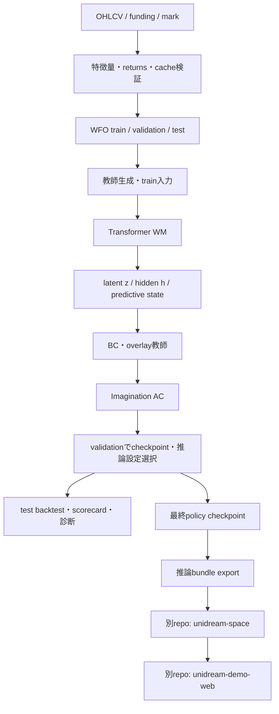

# UniDream プロジェクト仕様書

- 調査日: **2026-11-07（JST）**
- 対象: 本リポジトリの `main`、変更前commit `fc2c608e66d71d8a9f31bd73cc9f6a15926c64a5`
- バージョン: package `0.1.0`、現行mainline **Plan011 v31**
- 調査範囲: Python実装104ファイル、テスト49ファイル、YAML設定15ファイルの構成調査と、主要実装・設定・テスト・保存済み報告の照合
- 全ファイルと検証結果: [仕様調査台帳](docs/specification_inventory.md)

本書は目的、構成、入出力、学習、評価、成果物、研究用拡張、実装上の制約をまとめる。現行の実行契約は本書、使い方と概要は [README](README.md)、実験の数値とprovenanceは個別報告・機械可読成果物を参照する。

「現行契約」はmainlineで守る条件、「研究用拡張」は別実験で使う実装、「履歴」は過去の実行記録を表す。今回、学習の再実行・経済結果の再計算・外部APIの稼働確認・配備は行っていない。過去の成功や公開サービスの状態を、今回再確認した事実とは扱わない。

## 目次

1. [目的・対象・達成条件](#1-目的対象達成条件)
2. [システム構成・境界](#2-システム構成境界)
3. [機能要件](#3-機能要件)
4. [実行環境・依存関係](#4-実行環境依存関係)
5. [設定・CLI契約](#5-設定cli契約)
6. [データ・特徴量](#6-データ特徴量)
7. [cache・availability・欠損](#7-cacheavailability欠損)
8. [WFO・情報境界](#8-wfo情報境界)
9. [教師生成](#9-教師生成)
10. [Transformer World Model](#10-transformer-world-model)
11. [Actor・Behavior Cloning](#11-actorbehavior-cloning)
12. [Imagination Actor-Critic](#12-imagination-actor-critic)
13. [Validation selector・test評価](#13-validation-selectortest評価)
14. [checkpoint・再現性](#14-checkpoint再現性)
15. [推論bundle・外部連携](#15-推論bundle外部連携)
16. [研究用拡張](#16-研究用拡張)
17. [保存済み結果の位置づけ](#17-保存済み結果の位置づけ)
18. [制約・文書との差分](#18-制約文書との差分)
19. [運用・検証・受入条件](#19-運用検証受入条件)
20. [参照資料](#20-参照資料)

## 1. 目的・対象・達成条件

UniDreamは暗号資産市場の時系列を学習し、Buy & Hold（B&H）に対する超過リターンとリスク改善を検証する研究システムである。World Model（WM）で市場状態を表現し、Behavior Cloning（BC）で初期方策を学習し、WM内の想像軌道でActor-Critic（AC）を調整する。

現行mainlineは **BTCUSDT / 15m**。B&Hの絶対exposure `1.0` を基準とする低回転overlay actorで、現行の絶対position範囲は `[0.50, 1.12]`。出力は連続的なposition pathで、取引所の注文ではない。

| 区分 | 条件・内容 |
|---|---|
| 主要経済目標 | 同じ窓・cost・benchmarkで `AlphaEx >= +3pt` かつ `MaxDDDelta <= -3pt` |
| M2必須条件 | 上記に加え `SharpeDelta >= 0.20`、期間勝率 `>= 0.60`、collapse guard通過 |
| stretch | `AlphaEx >= +10pt`、`MaxDDDelta <= -5pt`。実装の `stretch_hit` はいずれかの成立 |
| 現行の結論 | Plan011保存済み報告では主要目標未達、ACの明確な追加優位性も未確認 |
| 本repoの成果 | 学習、比較、監査、再現性artifact、推論bundle、研究証跡 |
| 別システムの責務 | HTTP推論サービス、Web UI、永続paper account、リアルタイム配信 |

学習の完走、M2合格、統計gate合格、公開推論成功、実運用成績はそれぞれ別の状態として記録する。

## 2. システム構成・境界



以下のpathは `unidream/` 配下。

| 層 | 主要実装 | 責務 |
|---|---|---|
| CLI | `cli/` | 学習、評価、監査、図表、exportの引数解析 |
| run管理 | `experiments/train_app.py`, `run_config.py` | 設定・データ検証、run directory、manifest |
| fold管理 | `train_pipeline.py`, `fold_training.py`, `wfo_runtime.py` | seed再設定、dataset生成、stage順序制御 |
| データ | `data/download.py`, `features.py`, `dataset.py` | 取得、因果的特徴量、sequence・WFO dataset |
| 教師 | `data/oracle.py`, `experiments/oracle_*.py`, `overlay_teacher.py` | hindsight教師、平滑化、BC用overlay |
| WM | `world_model/` | encoder、causal Transformer、補助予測head、学習 |
| 方策 | `actor_critic/` | inventory controller、BC、critic、想像軌道学習 |
| 評価 | `eval/backtest.py`, `selector.py`, `policy_stats.py` | コスト付き評価、validation選択、行動統計 |
| 研究基盤 | v4、OOF、`experiments/p1_*.py` 等 | availability、認証artifact、固定実験、統計評価 |
| 証跡 | `docs/`、一部の追跡済み `codex_outputs/` | 報告、図表、固定結果・manifest |

学習の呼出順は `cli.train.main → run_training_app → run_wfo_folds → run_fold`。`run_fold` がWM、BC、AC、validation selector、testを実行する。研究runnerや補助機能の存在だけで、mainlineの一部とは判断しない。

## 3. 機能要件

| ID | 要件 | 実装・テストの主な根拠 |
|---|---|---|
| F01 | YAML・seed・deviceから独立した学習runを開始する | `cli/train.py`, `run_config.py`, `test_strict_training_config.py` |
| F02 | 完全一致cacheを検証し、features/returnsを同じindexで供給する | `runtime.py`, `test_reproducible_artifacts.py` |
| F03 | 特徴量へ意思決定後の値を入れない | `features.py`, `test_leak_discipline.py` |
| F04 | train/validation/testを右端排他で分割する | `dataset.py` の境界実装、`test_availability_contract.py` の分割伝播検証 |
| F05 | WM→BC→ACをfoldごとに新規学習する | `fold_training.py`, 各stage |
| F06 | validationだけでcheckpoint・推論設定を選択する | `ac_stage.py`, `val_selector_stage.py`, `selector.py` |
| F07 | 選択後のtestをreport-onlyで評価する | `test_stage.py`, `m2.py` |
| F08 | artifactをrun/config/source/dataへ結び付ける | `checkpointing.py`, `run_config.py`, provenanceテスト |
| F09 | Actor runtimeとselector設定を復元する | `checkpoint_eval.py`, inference設定round-tripテスト |
| F10 | 別repo向け推論bundleを生成する | `cli/export_inference_bundle.py` |
| F11 | availabilityと連続時刻から有効sequenceを判定する | `availability_contract.py`, `window_quality.py`, 対応テスト |
| F12 | conditional経路でOOF・実在庫・実行契約を検証する | `chronological_oof.py`, `conditional_teacher.py`, P0/P1テスト |
| F13 | 研究比較のsource・mask・統計artifactを検証する | `p1_validation_forecast.py`, `p1_action_artifact.py`, `p1_mbb.py` |
| F14 | family比較、図表、forecast・alpha帰属等の診断を出す | 各評価CLIと対応する `eval/` |

F11〜F13は研究用拡張を含む。現行3設定がこれらをすべて利用するという意味ではない。

## 4. 実行環境・依存関係

- Python `>=3.12`、package管理は `uv`。宣言は [pyproject.toml](pyproject.toml)、解決済み依存は `uv.lock`。
- 主要依存: PyTorch、NumPy、pandas、PyArrow、pandas-ta、scikit-learn、matplotlib、hmmlearn、requests、SciPy、PyYAML。
- 配布script `unidream-train` は `unidream.cli.train:main` を呼ぶ。
- deviceは `auto / cuda / mps / cpu`。`auto` はCUDA→MPS→CPUの順。利用不能な明示指定はエラー。
- 標準の本学習手順ではNVIDIA環境の `--device cuda` を明示する。CPU/MPSにもコード経路はあるが、処理時間・メモリ量の定量SLAはない。
- Python・NumPy・PyTorchのseedを設定し、deterministic algorithmsを有効にする。異なるhardware/library間の完全一致まで保証する仕様ではない。
- 利用条件は [LICENSE](LICENSE) のPolyForm Noncommercial 1.0.0表記を参照。市場データ由来の文書には個別の帰属・利用注記がある。

## 5. 設定・CLI契約

### 5.1 学習entrypoint

```bash
uv run python -m unidream.cli.train
uv run python -m unidream.cli.train --config configs/trading.yaml --seed 7 --device cuda
```

公開引数は `--config`、`--seed`、`--device` とhelpのみ。既定は `configs/trading.yaml / 7 / auto`。引数略記は許可しない。

期間・fold・cost・checkpoint/cache pathはYAMLだけで指定する。学習CLIの `--resume / --start-from / --stop-after / --start / --end / --folds` は削除済み。mainlineではcheckpoint warm-start、stage途中開始、legacy Plan004/009互換を使わない。評価・export CLIは別の引数契約を持つ。

### 5.2 現行3設定

| 設定 | 期間 | folds | WM action context | forecast診断のdelay |
|---|---|---|---|---|
| `configs/trading.yaml` | `[2018-01-01, 2024-01-01)` | `0–12` | 未指定。コードfallbackは `oracle` | 未指定 |
| `configs/plan011_overlay_actor_v31_relative_constraint_ac.yaml` | 同上 | `0–12` | 明示的に `actionless` | 1 bar |
| `configs/plan011_overlay_actor_v31_holdout.yaml` | `[2018-01-01, 2026-04-17)` | `15–23` | 明示的に `actionless` | 1 bar |

`trading.yaml` と名前付き開発設定には `world_model.action_context` と `eval.forecast_execution_delay_bars` の差がある。別config hashとなり、同じ実行条件として交換できない。両開発設定のcheckpoint directoryは同じで、後から実行したrunがcleanする可能性がある。

### 5.3 必須YAMLと検証

```yaml
run:
  start: "2018-01-01"
  end: "2024-01-01"
  folds: [0, 1, 2, 3, 4, 5, 6, 7, 8, 9, 10, 11, 12]
  clean_checkpoint_dir: true
  deterministic_algorithms: true

data:
  symbol: BTCUSDT
  interval: 15m
  seq_len: 64
  include_funding: true
  include_oi: false
  include_mark: true

logging:
  checkpoint_dir: checkpoints/plan011_overlay_actor_v31_relative_constraint_ac_s007
  cache_dir: checkpoints/data_cache
```

`run` の5 keyはすべて必須、未知keyは拒否する。`folds` は重複なし非負整数list、または文字列 `all`。listは昇順へ正規化し、存在しないfoldは拒否する。start < end、bool型、明示的なinclude flag、空でない保存先も検証する。

`deterministic_algorithms: false` は拒否する。checkpoint/cache directoryは同一にも親子にもできない。`world_model.init_checkpoint`、`bc.init_checkpoint`、`ac.ignore_ac_checkpoint`、`plan004_residual_bc_ac` は拒否する。

strict検証は `run` と特定の必須・廃止fieldが対象で、全YAMLを網羅する単一schemaではない。研究用設定には別runnerのschemaがある。

| 主な設定 | 現行値 |
|---|---|
| WFO | train 2年 / validation 3か月 / test 3か月、3か月roll |
| 正規化 | rolling z-score 60日 |
| WM | 最大700 steps、batch 64、lr `1e-4` |
| BC | 5 epochs、batch 512、lr `3e-4`、chunk 4 |
| AC | 最大300 steps、batch 512、horizon 8 |
| actor / critic lr | `3e-5 / 3e-4` |
| cost | spread 3bps / fee `0.0003` / slippage 1bps |
| benchmark / bounds | `1.0 / [0.50, 1.12]` |

上限step数と実消化step数は異なる場合がある。early stopping・validation復元・curriculumを実行記録で確認する。

## 6. データ・特徴量

### 6.1 取得と時刻

mainlineは `data/download.py` でBinance Spot OHLCV、Futures funding、mark-price klinesを取得する。OI取得もあるが現行3設定では無効。Spot taker proxy、taker buy/sell、複数symbol取得も実装されている。

特徴量行 `t` は基本的に `t-1` までの確定情報を使う。生returnsは `r_t = log(close_t / close_(t-1))`。特徴量へ入れるときにshiftし、評価の実現returnsはshiftしない。UTCの市場時刻とJST表示を区別する。v3は既存index表現を維持し、全経路でtimezone-awareであることまでは要求しない。

### 6.2 canonical 17特徴量

列順はmodel/bundle契約の一部。標準の生成順は次のとおり。

| 列番号（0始まり） | 列 | 内容 |
|---|---|---|
| 0–4 | `open_ret`, `high_ret`, `low_ret`, `close_ret`, `vol_ret` | 各系列の1本前までの対数変化 |
| 5 | `RSI_14` | RSI period 14。列名はcache契約と一致させる |
| 6–7 | `macd`, `macd_signal` | fast 12 / slow 26 / signal 9 |
| 8 | `atr_norm_ret` | close対数return / 価格比ATR |
| 9 | `atr` | ATR period 14 |
| 10–12 | `rv_4`, `rv_16`, `rv_96` | 1h / 4h / 24hの実現volatility |
| 13 | `funding_rate` | as-of forward fill、shift |
| 14–16 | `basis`, `basis_mom`, `basis_abs` | Spot/mark乖離と派生量 |

`OHLCV13` は外部系列4列を除く比較用group、`full17` は全列。availability flagをモデル列へ追加しない。OI・追加系列・rebound/context拡張は別の入力契約になる。

z-scoreは15mで `60×96=5760` 本、`min_periods=1440`。全期間fitのscalerは使わない。ゼロvolume等のinfはNaN化し無効行を除くため、特徴量の行数・先頭時刻は生OHLCVと異なる。

mark/OI開始前を未来値でbackfillしない。v3のfunding開始前やbasis欠損の一部は0にするが、観測0と欠測を識別できる証明にはならない。basis派生量には追加shiftがあり、全列のlagが厳密に同じ1本とは限らない。

TA指標にはpandas-taとfallback実装があり、環境差を生み得る。再現時は依存・source・cacheを固定する。

## 7. cache・availability・欠損

### 7.1 現行v3

既定tagは `{symbol}_{interval}_{start}_{end}_z{days}_v3`。`<tag>_features.parquet`、`<tag>_returns.parquet`、`<tag>_metadata.json` を用いる。raw OHLCV/funding/OI/markも同tagで扱う。wildcard探索や別期間cacheへのfallbackはしない。

v3 metadataの `schema_version` は **1** で、tagのv3とは別番号。include flag、要求parameter、列・列順、行数、先頭/末尾時刻、単調で一意なDatetimeIndex、features/returnsのindex一致、数値の有限性を検証する。

metadataなしの旧cacheはbody検証後に `provenance=legacy_unverified` のsidecarを作れる。品質状態は `legacy_v3_unverified`。不正v3 hitはraw再構成へ進む経路があり、必ず即時停止する契約ではない。

v3の構造検査合格は、15分足の連続性やexternal availabilityの証明ではない。別CLIのquality gateが監査する。

### 7.2 実装済みv4

`data.cache_schema: v4` と必要に応じた `data.cache_tag` で明示選択する。現行3設定は既定v3。

| artifact | 内容 |
|---|---|
| `<tag>_features.parquet` | feature body、availability列を混ぜない |
| `<tag>_returns.parquet` | bodyと同indexの1列returns |
| `<tag>_availability.parquet` | 期待される全時刻gridとbool flag |
| `<tag>_metadata.json` | schema 4、列・行、gap policy、source/content/schema digest |

`spot_bar_observed` は必須。funding/mark使用時は `funding_rate_available`、`mark_close_available` も必要。strict boolで欠測不可。bodyはfull gridのsubsetを許容するが、全body時刻がsidecarに存在する必要がある。

不完全な4ファイル、不正digest、index/列不一致を拒否する。旧downloaderへの黙ったfallback、sort・補間・zero fillによる修復はしない。品質状態は `v4_verified`。

`exclude_windows_crossing_gaps` に従い、全行のrequired availabilityがtrueで隣接時刻が厳密に15分のsequenceだけを採用する。`SequenceDataset.valid_starts` は元bodyへのoffsetを保持する。`WFODataset` はattrsと `FeatureArray` でsidecarを伝播し、欠損を詰めて連続sequenceと誤認することを防ぐ。

配列全体を直接encodeして評価する経路すべてが、有効window/maskのみへ統一済みではない。dataset伝播完了とmainline評価全体のavailability対応を区別する。

### 7.3 監査・再構成

- `verify_data_quality`: 開発期間の構造、連続性、非有限値、因果性、external coverage、OHLCV13/full17同一行を監査。
- `audit_official_gap_recovery`: 公式sourceから欠損候補を調べるread-only監査。
- `rebuild_official_v4_cache`: 公式archive/checksum、REST補完、off-grid隔離を使う明示的再生成。
- `acquire_d1_signed_flow`: signed-flow pilotの取得・集計・証跡生成。

過去のv3監査は542個の期待時刻欠損を対象とした。別の公式v4再構成報告は531 unresolved、81 off-grid隔離、173,111 feature rows。sourceと処理が違うため同一cacheの前後差として差し引かない。報告の生成先には過去環境の `/tmp` が含まれ、現環境での実在は報告だけから保証しない。

## 8. WFO・情報境界

`get_wfo_splits` は最初の有効feature timestampをanchorに、train 2年、validation 3か月、test 3か月をrollingで作る。test幅の3か月ずつ進み、完全なtest区間を確保できるfoldを採用する。`min_folds` 引数は存在するが、現実装では最低fold数を強制しない。

実データsliceはすべて **`[start, end)`**。隣接testの境界バーを二重計上しない。warmup後の先頭がanchorなので、暦月1日00:00開始とは限らない。

| 領域 | 許可用途 |
|---|---|
| train | WM/BC/AC fit、教師、予測状態mean/std、学習用補助値 |
| validation | checkpoint・推論設定・比較手法parameterの選択 |
| test | 最終方策の報告・図表・scorecard、選択へ戻さない診断 |
| historical holdout | 当時の未使用期間としての履歴。後続再実験では既知期間 |

foldごとにseedを再設定し独立artifactを作る。前fold checkpointを次foldへwarm-startしない。

HMMを方策入力に使う経路ではtrainでfitし、futureを使うforward-backward smoothingでなくcausal filteringを使う。現行の `feature_stress_tri` は特徴量由来のregimeを構成する。学習末尾で全testからfitするHMM分析はreport-onlyで方策へ戻さない。

## 9. 教師生成

教師は `compute_base_oracle → compute_teacher_oracle → apply_oracle_postprocess` を経て、BCでは専用overlay教師を適用する。

現行は `teacher_mode=signal_aim`。将来returnを使うhindsight signalからaim positions・soft labels・smooth pathを作る。基本action値 `[0,0.5,1,1.25]`、signal horizons `[4,16,64]`、重み `[0.2,0.3,0.5]`、aim max step `0.1`、band `0.02`、soft-label temperature `0.5`。transition advantage relabelも有効で、horizons `[4,8,16,32]` とcost/DD/volatility penaltyを使う。

BCは `benchmark_overlay_teacher=true`、`lowfreq_wm_overlay` を使い、WM予測状態と過去returnから低頻度risk/edge/trend overlayを作る。最終BC教師を元のhindsight action pathそのものと説明しない。

| BC教師parameter | 値 |
|---|---|
| benchmark / overlay範囲 | `1.0 / [-0.30,+0.12]` |
| EMA span / minimum hold | `256 / 32` bars |
| trend lookback | `128` bars |
| max step / deadzone | `0.08 / 0.012` |

mainlineのtrain predictive stateは同じtrainで学習したWMの出力で、chronological OOFではない。未来由来教師を意思決定時点で直接利用可能なOracleと同一視しない。

conditional研究経路ではcurrent inventoryを `actual_replay / benchmark_replay / policy_replay` に限定し、hindsight/teacher/oracle pathを現在在庫へ流用することを拒否する。

## 10. Transformer World Model

### 10.1 構造

| 要素 | 現行設定・挙動 |
|---|---|
| observation | 17次元、学習sequence 64 |
| encoder | 2層MLP、hidden 192、ELU |
| latent | 32 categoricals × 32 classes、flatten後 `z_dim=1024` |
| encode | 学習時straight-through sample、評価時probability vectorで決定的encode |
| dynamics | causal Transformer、model 192、2 layers、4 heads、FF 768、dropout 0.1 |
| 最大sequence | 128、学習sequence 64とは別 |
| 入力 | z/actionを各embedして加算、位置encoding、causal attention |
| 出力 | h、次latent prior、reward、done、観測再構成 |
| ensemble | 現行 `n_ensemble=1`。クラスは複数model対応 |
| reward | symlog twohot、255 bins、範囲 `[-20,20]` |

named v31の `actionless` はaction vectorを削除する意味ではない。train/validationへbenchmark相当の固定actionを入れ、`encode_sequence(actions=None)` とcontextを揃える。`trading.yaml` のfallback `oracle` はdataset actionを利用し得る別経路。

`n_ensemble=1` ではmodel間disagreementは0になり、複数model由来の不確実性penaltyは働かない。sequence encodeは最大64本の直前contextをwarmupに付けて処理し、現設定では合計最大128本になる。

### 10.2 損失と補助head

主損失は再構成、KL dynamics/representation、twohot reward、done。free bits `1.0`、dyn `0.2`、rep `0.05`、recon `0.3`、reward `0.3`、done `0.0`。IDM係数は `0.05` だが、有効なaction label等が必要で、係数の存在だけでは学習の証拠にならない。

WMのreward教師は `position*raw_return - rebalance_cost` で、excessモードではさらに `benchmark*raw_return` を引く。actionlessでpositionを常にbenchmark1とした現設定では、各学習sequenceの初回entry cost以外のreward教師は0になる。未来return/riskの補助head教師は別途raw returnsから作る。

補助headはreturn、volatility、drawdown、crash、drawdown excess、position utility、overweight advantage、recovery。regime headも条件に応じて構成する。補助headへraw featuresを渡す設定が有効。

- return/risk horizonsは `[4,8,16,32,64]`。returnは `return_include_current=false`。
- return/risk target scaleは100、crash/drawdown-excess閾値 `0.012`。
- position utilityはhorizon64、候補絶対position `[0.50,0.70,0.85,0.94,1.0,1.06,1.12]`。
- utility教師はB&Hとの差分return、rebalance cost、DD悪化/改善、volatility exposureから構成する。
- validationは既定で順序を保った全batchを評価し、best復元はensembleと全active headを一貫したsnapshotで行う。

### 10.3 Predictive state・coverage

選択した8種類の補助headを連結し、通常の現行構成では42次元をActorへ渡す。mean/stdはtrainだけから求めvalidation/testへ同じ変換を適用。極小stdは1へ置換、clip `±5`、scale `1.0`、float32。headと列順もartifact契約に含む。

| 内部データ | 形状（Tは対象splitの行数） |
|---|---|
| features / raw returns | `(T,17)` / `(T,)` |
| encoded latent z / hidden h | `(T,1024)` / `(T,192)` |
| predictive state | 通常 `(T,42)` |
| Actor position path | `(T,)`、絶対exposureのfloat32 |

`target_gradient_coverage.jsonl` にhead/horizon/output別の有効target数、mask比率、有限loss、実勾配step、非zero勾配等を保存する。future-onlyの `seq_len=64` ではh64とutility horizon64の有効targetが0になる。出力値や有限の総lossだけでは学習済みheadと判断しない。

現行coverageは基本的に診断用。conditional指定、または `require_target_gradient_coverage=true` なら不足時に停止する。blocked marker付きcheckpointは通常loadも拒否し、明示的なlegacy診断overrideだけを別扱いにする。

## 11. Actor・Behavior Cloning

Actorは `z / h / regime / controller state / predictive state` からtrade signal、target inventory、target std、no-trade band等を出す。単純な4択classifierだけでなく、inventory controllerとして連続positionを生成する。

2層hidden256、dropout `0.05`、controller state4次元、advantage concatが現行。stateは現在overlay在庫、前回変化、hold、underweightに関する情報を持つ。内部overlayをbenchmarkへ加算して絶対positionへ戻す。

| parameter | 現行値 |
|---|---|
| residual overlay / absolute bounds | `[-0.50,+0.12] / [0.50,1.12]` |
| max position step | `0.08` |
| band設定 / target std範囲 | `min_band=0.005, max_band=0.08` / `[0.02,0.12]` |
| infer temperature / trade threshold | `1.0 / 0.7` |
| infer min trade floor / gap / scale | `0.08 / 0.015 / 0.06` |
| 現行offの拡張 | route、inventory recovery、benchmark floor/overweight adapter等 |

greedyでも連続調整率とsigmoid band gateを使う。bandが全経路共通の厳密な離散取引禁止幅とは限らない。時系列順にcontroller stateを更新してposition pathを作る。

bandの基本式は `min_band + max_band * sigmoid(logit)`。現行値で幅は約 `0.005–0.085` となり、設定名 `max_band` をそのまま幅の絶対上限0.08とは読まない。

BCは教師のtarget/trade/band/execution、residual等の補助損失で学習する。5 epochs、batch512、chunk4、sample quality `outcome_edge`。SIRL hidden0、class balancing false、route関連係数の多くは0。

BCのaction chunking4本と、conditional actionの4本commitmentは別機能。chunk設定だけで執行時刻やscore maskが切り替わることはない。

## 12. Imagination Actor-Critic

train stateを起点にWMのlatent dynamics上で8stepの想像軌道を作る。criticはtwohot value、EMA target decay `0.98`、discount `0.99`、lambda `0.95`。ActorはBC priorとentropy正則化を伴い更新する。

現行 `reward.mode=excess_bh`、`reward_objective=relative_constraint`。予測excess returnの `log1p(clamp(...))` とreward EMA scaleを使い、相対wealth、相対DD、終端DD、alpha shortfall、負tail、overlay exposure等を組み合わせる。

| 主な係数 | 値 |
|---|---|
| relative DD / budget | `2.5 / 0.0005` |
| terminal relative DD | `0.35` |
| alpha floor coefficient / floor | `2.0 / 0.0` |
| relative tail（設定名 `relative_cvar_coef`） | `0.20` |
| overlay L2 / underweight L1 / overweight L1 | `0.010 / 0.050 / 0.005` |
| turnover / upside miss | `0.14 / 2.0` |
| entropy scale | `0.012` |
| BC α schedule | `0.35 → 0.05`、260steps、adaptive BC有効 |

`relative_cvar_coef` は実装上、負returnのhinge penaltyで、tail分位点を推定する一般的なCVaR最適化そのものではない。相対DD報酬とtestの絶対MaxDDDelta改善は別の量。

`online_wm_interval=0` なので現行はAC中にonline WM更新しない。validation best復元はBC開始点へ戻る場合もあり、AC実行と最終Actorへの更新残存は別に確認する。

curriculum、段階的trainable scope、bounds変更、stage checkpointは実装済みだが、現行v31は `curriculum=[]`。Plan013〜015の研究設定へ分離されている。

## 13. Validation selector・test評価

### 13.1 選択

1. WM validation loss、AC validation評価でstage内bestを選ぶ。
2. 学習後にvalidationで推論設定を比較する。adjust-rate scale gridは `[0.7,1.0,1.3]`。
3. 選んだscale/advantage levelとActor runtimeを最終policyへ保存し直す。
4. 選択済みActorのtest結果をreport-onlyで出す。

selectorはAlphaEx、SharpeDelta、絶対DD、MaxDDDelta、期間勝率、turnover、方向偏り、M2等をscore化する。現行turnover上限6.5。近い候補では既定conservative tie-breakで低回転等を優先する。

**全候補rejectでも、その候補集合から選ぶfallbackがある。** selectorの返却だけで品質合格とせず、M2・reject理由を別に確認する。

### 13.2 mainline会計・delay

```text
cost_t = abs(position_t - position_(t-1))
         * (spread_bps / 20000 + fee_rate + slippage_bps / 10000)
pnl_t = position_t * log(close_t / close_(t-1)) - cost_t
equity_t = exp(sum(pnl_0 ... pnl_t))
```

Δposition1の片道costは `1.5+3+1=5.5bps`。benchmarkも同じcost関数で計算する。legacy既定は初期flatからのentry costを計上し、fold間でaccount stateを持ち越さない。

これはfraction positionと対数returnによる近似会計。asset units/cashの正確なself-financing会計、板、借入、強制清算、実際のfunding支払をすべて表現するものではない。funding特徴量があることとfunding cashflow決済は別。

通常のmainline selector/testは `Backtest` の既定delay0を使う。`eval.forecast_execution_delay_bars=1` はforecast診断向けで、mainline全体のdelayを変えるswitchではない。明示delay評価は `positions[:-d]` と `returns[d:]`、benchmarkも同期間へ揃える。

### 13.3 指標

| 指標 | 定義 |
|---|---|
| total return | `equity[-1]-1` |
| AlphaEx（pt） | `100×(strategy total return - B&H total return)`、最終値差・非年率 |
| annual alpha | 両者の幾何年率return差、別field |
| MaxDD | equityのrunning peakからの最小drawdown、実装値は非正 |
| MaxDDDelta（pt） | `100×(abs(strategy MaxDD)-abs(B&H MaxDD))`、負が改善 |
| Sharpe | per-bar mean/std × sqrt(35040)、15m crypto |
| Sortino | 分母 `sqrt(mean(min(pnl,0)^2))`、全行平均 |
| Calmar | 幾何年率return / abs(MaxDD) |
| bar win rate | 同じbarのnet PnLがB&Hを上回る割合 |
| period win rate | 2920本（月相当）ごとの累積net PnL差が正の割合、selector/M2既定。暦月分割ではない |
| action long/short/flat | benchmarkとの差が `>0.05 / <-0.05 / その他` |
| action turnover | 隣接positionの絶対差合計、初期entryを含むcostとは範囲が異なる |

mainlineのshortはB&Hよりunderweight、flatはbenchmark近傍を表す。絶対空売り・現金化と同義ではない。MaxDD配列は初期equity1を前置しないので、最初のbarの損失を完全には捉えない。

学習末尾のPBOは簡易診断、DSR表示は `n_trials=1` のSharpe t-stat。正式な探索回数補正DSR/CSCVには別の `eval/statistical_gate.py` を使う。

## 14. checkpoint・再現性

### 14.1 run生成・状態

データ取得/cache検証とfold選択の後にrun directoryを準備する。`clean_checkpoint_dir=true` なら削除して再作成。root/home等への危険なcleanは拒否する。falseで既存directoryが非空なら停止する。

```text
<logging.checkpoint_dir>/
  resolved_config.yaml
  run_manifest.json
  fold_<n>/
    world_model.pt
    bc_actor.pt
    ac.pt
    target_gradient_coverage.jsonl
```

`resolved_config.yaml` はcost profile解決後の設定。現行AC有効runは3stageを必須とする。AC無効の研究構成ではBCを最終policyにできる。

manifestとcheckpoint metadataのschemaは2。開始時 `running`、正常finalizeで `completed`、artifact不足/不正で `incomplete`。途中例外でrunningのまま残る場合もあり、directoryの存在を完了判定に使わない。

### 14.2 保存情報・hash

- run ID: config/source/data fingerprintとseedから20桁hexを生成。
- config: canonical JSON hash、resolved snapshot。
- source: `unidream/**/*.py`、`pyproject.toml`、`uv.lock` のpath/内容。
- data: index、float32化したfeatures/returns、列名順。
- Git commit/dirty、seed/device、Python/torch/NumPy/pandas/platform、cache tag、folds、必須stage一覧。
- checkpointごとのstage/fold/run/config/source/data provenance。
- Actor推論runtime、最終scale/advantage、selector候補score・理由。

torch/textの主要保存はtemporary file→renameでatomicにする。semantic hashはZIP bytesではなく、payloadのtensor/arrayのdtype・shape・値とdict/list/scalar等を再帰hashする。重みだけのhashではなくmetadata等でも変化し得る。

### 14.3 replay受入

共有loaderはcompleted manifest、内部resolved config hash、呼出側config hash、checkpoint metadataを照合する。別config、未完了run、stage/fold不一致を拒否する。既知optional headの欠落を扱うhelperがあっても、無provenance旧artifactをmainlineへ無条件許可する契約ではない。

WM/BCのsemantic fingerprintはreplay時にも計算して返すが、現loaderにはmanifestの保存済みsemantic hashとの一致を強制する比較はない。metadata照合だけでcheckpoint内容の改変まで検出するとは保証しない。またmanifestのsource/data hashと、replay時の現在source/入力dataを一律に再計算照合する仕組みとも区別する。

state_dictだけでなくruntime overrides、bounds、selector結果を復元して、学習直後と後日の推論を揃える。

## 15. 推論bundle・外部連携

`cli.export_inference_bundle` はcompleted runのfoldからbundle version2を作る。`--run` は `label=checkpoint_dir[@filename][:ac|:bc]`。学習CLIとは別に期間・fold・sample-bars・output-dir等を受け付ける。

| 出力 | 内容 |
|---|---|
| `manifest.json` | type、source run、data列順、split、policy、regime、artifact一覧 |
| `actor_full.pt` | runtimeを含むActor object |
| `checkpoints/world_model.pt` | WM |
| `checkpoints/bc_actor.pt`, `checkpoints/ac.pt` | 元policy checkpoint copy |
| `model_config.yaml` | resolved config |
| `predictive_state.npz` | train由来mean/std、予測列名 |
| `sample_input.npz` | features/returns/regime/advantage/expected positions/timestamps |
| `sample_output.json` | expected position末尾等 |

BTC配布契約として記録されるtypeは `plan011_v31_overlay_actor`、17特徴量、sequence64。CLI既定typeはgenericなのでconsumer向けtypeを明示する。`sample-bars=0` はtest全体。sampleは検証用でtestをfitへ戻さない。

exportはv3 tagを組み立てる実装なので、trainの明示v4選択まで完全共通化されたexportとは扱わない。consumer側でfeature pipeline・position parityを確認する。

`unidream-space` は推論backend、`unidream-demo-web` は市場data orchestration、paper account、dashboard等を担当する。本repoにFastAPI/Next.js/Supabase本体が含まれるわけではない。

保存済みproject mapではBTC API入力はcandle arrays、legacy `returns/history_returns` は非対応。完全なHTTP schema、認証、rate limit、UI、現在の稼働はconsumer repoの確認範囲。

2026-09-05のBNB trend rule `/v2` 配備履歴は、BTC Plan011 `/predict` と別model・別経路。BTC mainlineをBNBへ置換する契約ではない。README等のcurrentは記録時点として読む。

## 16. 研究用拡張

### 16.1 系統一覧

| 系統 | 実装・設定 | 状態・境界 |
|---|---|---|
| Plan012 | absolute constraint reward probe | development 0/2/8、非mainline |
| Plan013〜015 | curriculum、stage選択、residual adapter | 保存済みprobe、現行設定と分離 |
| Alpha attribution | `eval/alpha_attribution.py` | 定数exposure、timing、shift/shuffle、head診断 |
| Wave3A | `eval/forecast_tournament.py` | development限定、予測とcost後timingを分離 |
| Wave3C | `eval/forecast_context_tournament.py` | causal context/downside、quality gate |
| Wave3D | `eval/constant_exposure_diagnostic.py` | folds0–11固定、validationで定数exposure選択 |
| D1 | `data/d1_signed_flow.py` | archive、因果的flow、取得ledger |
| P0 availability | v4/runtime/dataset/mask | dataset伝播実装、評価全体統一は未完 |
| P0 conditional | OOF・inventory・action契約 | strict guard、専用diagnostic runner |
| P1 recovery | `experiments/p1_*.py` | 認証forecast→action→bootstrap→固定gate |
| Alpha/DD | `alpha_dd_data.py`, `alpha_dd_search.py` 等 | 別Spot取得・cash/units会計・selection lock |
| ML25 | `alpha_dd_ml.py`, `alpha_dd_features.py` | 欠損対応ML continuation、別登録 |
| Robust overlay | `robust_overlay.py` | 7/30/90日合意、6h cadence |
| HF検証 | `export_alpha_trend_fixture.py`, `verify_alpha_trend_space.py` | 固定revision・実履歴parity・応答記録 |

10月の研究集約報告は別構成の市場/リスク予測とforward観測を含み、全実装がこのcheckoutに存在するわけではない。17特徴量Plan011と31特徴量の別demo等を混ぜない。

### 16.2 Conditional Oracle

新経路は「予測可能性→chronological OOF→conditional teacher→direct policy/student→必要ならAC」の順。

- train label終了がoriginのpurge前までに確定していることを検証。
- early originはNaN/falseを保ち、in-sample予測で補完しない。
- prediction eligibility、training-label eligibility、score/outcome completenessは別mask。
- origin、cutoff、model/scaler/normalizer/calibrator等のprovenance、外部hash、row mappingを照合。
- mainline `run_fold` にconditional flagを付けるだけでは動かず、legacy教師へのfallbackを拒否。
- 専用 `p1_conditional_wm_bc_ac.py`、`p1_formal_forecast_wm_bc_ac.py` は認証teacherを実学習へ接続済みだが、診断をmainline昇格と扱わない。

### 16.3 Canonical action contract

```text
decision t → fill t+1 → returns[t+1:t+5] の4本commitment
candidate delta = {-0.08,-0.04,0,+0.04,+0.08}
absolute position = [0.50,1.00], p_start = 1.00
```

4本ごとの固定schedule。feature欠損はhold、fill欠損は未約定、fill後のoutcome欠損は在庫保持・scoreのみ除外。未来maskで過去約定を取り消さない。tailも4本そろわなければscoreしない。

decision/fill complete/outcome complete/executed/scored actionのmask・分母を分ける。conditional teacherとhindsight upper boundは同bounds/cost/replay幾何を使うがselectorは別。upper boundを因果的教師・特徴へ流用しない。

### 16.4 P1 artifact・統計

固定manifest、56 trial、16 comparison registryから、認証forecast、h4 action、保存済みMBB starts/result、Holm/Wilson/coverage、frozen validation decisionへ進む。validation合格後だけ固定outerをreport-onlyで最大1回実行する。

外部固定file SHAとcanonical content digest、source binding、field別mask registryを照合する。自己申告hashだけでは認証しない。strict loaderが発行するsealed capabilityを要求し、直接dataclass構築やfixtureはpromotion根拠にならない。

MBBは `L=8,16,32`、2,000 replicates、非循環startsを保存/再load。inventoryをresampleごとに再構成せず、保存済みprimitiveをresampleする。全16比較がそろってから固定familyのHolm補正をし、欠測/N/Aをpassにしない。

登録時の `results_observed=false` と実行後のvalidation/outer observed fieldは別。登録不変と結果未観測を混同しない。詳細は [P1 integration contract](docs/experiments/p1_validation_integration_contract.md)。

### 16.5 独立development統計gate

`cli.statistical_gate` は明示JSON pathを消費し、fold15以降を拒否する。paired block bootstrap・感度、明示trial数DSR、CSCV/PBO、sign test、cost/regime stressを評価。

CSCVは最低2候補・4以上の偶数subperiodが必要で、13foldのままならN/A。trial数未指定は診断のみでpromotion不可。点推定 `100*sum(per-bar differential)` は加算統計で、一般に最終equity差AlphaExとは異なる。

### 16.6 Alpha/DD・Robust overlay

公式checksum付きSpot archiveとavailability/source ledgerを使い、cash/asset unitsを追跡する。初期equity1・既存B&H1、次bar open fill、初期entry/終端清算の人工feeなし、借入年率10%の固定仮定。max step0.08、deadband0.01、片道5.5bps、2倍cost/borrow stress。

developmentの `min(mean AlphaEx,-mean MaxDDDelta)` 等で候補をlockし、historical/freshで選び直さない。coverage不足・fit不能をB&Hで置換しない。Robustは7/30/90日trend合意と90日backboneを半分ずつ使い、UTC00/06/12/18時に目標更新。

この別会計をmainlineへ移植済みとは扱わない。研究YAMLに過去環境の絶対pathがあり、そのまま現環境で実行可能とは限らない。

## 17. 保存済み結果の位置づけ

以下は過去報告の要約で今回の再計算ではない。会計・単位・窓が違う系列を無条件に比較しない。

| 系列 | 対象 | 主な記録 | 状態 |
|---|---|---|---|
| Plan011 v31 | 開発0–12 | 平均AlphaEx `+0.41pt`、DD delta `+0.20pt`、目標pass0/13 | 未達 |
| Plan011 v31 | 当時のholdout15–23 | `+0.11pt / +0.20pt`、DD改善0/9 | 未達 |
| WM+BC、ACなし | 同holdout | `+0.13pt / +0.24pt` | ACの追加優位性未確認 |
| P1 formal validation | 登録S0–S3 | 固定16比較gate PASS | synthetic/injectedを含むvalidation |
| P1 natural S3 outer | zero-injection control | Ridge additive AlphaEx `-0.207837` | B&H未満 |
| 登録source→WM/BC/AC | 9月5日診断 | BC underweight偏り、AC benchmark同等・fill0 | 接続成功、経済改善未確認 |
| Alpha/DD BTC | historical9+fresh1 | `-0.206849pt / -3.769641pt` | 最低alpha未達 |
| Alpha/DD BNB rule | 同10窓 | `+1.356381pt / -6.251727pt` | 最低条件のみ、preferred未達 |
| Robust BTC overlay | 同10窓 | `+1.629588pt / -4.751632pt`、2倍stress `+1.212933pt / -4.654601pt` | preferred未達、確認期間再利用 |

fold15–23はPlan011当時には未使用だが、後続逐次研究では既知期間。P1 PASS、BNB公開推論成功、Robustの正の平均から未観測期間のBTC neural policy優位性を導かない。

## 18. 制約・文書との差分

| ID | 事実・制約 | 扱い |
|---|---|---|
| D01 | tradingはWM context未指定、named v31はactionless | 同一config/同一学習と表現しない |
| D02 | seq64のfuture-only h64/utility64は有効教師0 | head出力だけで学習済みとしない |
| D03 | v3はavailabilityなしでも読める | legacy unverifiedと明示 |
| D04 | 古いv4文書は未生成/未接続と記載、後続でrebuild/runtime/dataset実装 | 履歴と現コードを区別、評価全体統一は未完 |
| D05 | mainline delay0、forecast診断1 | 全実験共通delayとしない |
| D06 | mainline対数PnL、Alpha/DD cash/units | 会計・fee・初期条件・DDを分ける |
| D07 | 全candidate rejectでもselector fallback | 選択済みと合格を分ける |
| D08 | BTC current記述とBNB v2履歴は時点・経路が違う | 公開稼働は別途確認 |
| D09 | 過去絶対path・削除済みcheckpoint・local output参照あり | 履歴pathを現環境の実在証明にしない |
| D10 | gitignore除外でもP1 checkpoint等の一部は明示追跡 | 全checkpoint不在と断定しない |
| D11 | 10月集約には別構成の成果がある | 単一checkoutの性能としない |
| D12 | tests成功と経済・統計優位性は別 | code/data/economic gateを別記録 |
| D13 | replayは保存済みsemantic hashとの一致を強制しない | metadata provenanceと内容完全性の検証を区別 |

本書は仕様整理であり、学習条件・モデル・経済判定を変更するものではない。

## 19. 運用・検証・受入条件

### 19.1 基本手順

```bash
uv sync
uv run python -m unidream.cli.train --help
uv run python -m unidream.cli.train --config configs/plan011_overlay_actor_v31_relative_constraint_ac.yaml --seed 7 --device cuda
```

holdout再現は `configs/plan011_overlay_actor_v31_holdout.yaml` を使う。YAML変更実験は別configに保存。clean対象directoryを把握し、別run artifactを混在させない。

```bash
uv run python -m unidream.cli.verify_data_quality
uv run python -m unidream.cli.audit_official_gap_recovery
```

quality failはexit1、gap監査も未解決なら非zero。`--allow-quality-gate-fail / --allow-unresolved` は証跡収集overrideで合格への変更ではない。統計gate rejectは既定exit2。

### 19.2 評価・補助CLI

以下は `python -m unidream.cli.<module>` で実行する。

| module | 用途 |
|---|---|
| `compare_policy_families` | B&H、vol-target、tabular ML、WM-only、BC-only等 |
| `plot_plan011_fold_trades` | equity・B&H・取引点の図表 |
| `evaluate_alpha_attribution` | exposure/timing・predictive head診断 |
| `evaluate_forecast_tournament` | development forecast/timing |
| `evaluate_forecast_context_tournament` | context/downside比較 |
| `evaluate_constant_exposure_diagnostic` | 12fold定数exposure |
| `statistical_gate` | 明示JSONの統計評価 |
| `rebuild_official_v4_cache` | 公式sourceからv4生成 |
| `acquire_d1_signed_flow` | D1取得pilot |
| `export_inference_bundle` | completed modelの配布artifact |

CLI/研究runnerごとのreport・registration・helpを確認し、固定済み証跡を上書きしない。

### 19.3 検証・受入

変更後の必須コマンド:

```bash
uv run python -m unittest discover -s tests -v
git diff --check
```

テストはstrict設定、因果性、cache/availability、評価、head coverage、Actor runtime、OOF、実行mask、artifact binding、MBB、統計、Alpha/DD・Robust等を扱う。全ファイル・検証結果は [調査台帳](docs/specification_inventory.md)。

checkpoint loader/bundle export変更時は現行v31 checkpointのload/export/replay smokeも必須。mainline checkpointがなければ再生成か所在確認が必要で、P1 pilotでは代用しない。今回の変更は仕様・案内文書のみ。

通常のcache/run checkpointと `.venv` はGit管理対象外。長期保存は報告・config・source・manifest/hash等。配布bundleと明示追跡済み研究証拠は個別保存対象として扱う。

## 20. 参照資料

- [README](README.md) / [開発指示](AGENTS.md) / [実験入口](docs/README.md) / [全ファイル調査台帳](docs/specification_inventory.md)
- [repo間責務](docs/project_map.md)
- [Plan011開発evidence](docs/plan011_v31_investor_evidence.md) / [holdout](docs/plan011_v31_holdout_2024_2026.md) / [family比較](docs/policy_family_holdout_comparison.md)
- [quality gate](docs/data_quality_gate_2018_2024.md) / [v4契約履歴](docs/data_quality_cache_v4.md) / [v4再構成](docs/data_quality_v4_rebuild_2018_2024.md)
- [availability](docs/experiments/p0_a_availability_report.md) / [target・OOF](docs/experiments/p0_b_target_oof_report.md) / [action](docs/experiments/p0_c_action_execution_report.md)
- [研究roadmap](docs/predictable_data_conditional_oracle_roadmap_2026.md) / [仮説registry](docs/experiments/predictable_oracle_hypothesis_registry.md)
- [P1 integration](docs/experiments/p1_validation_integration_contract.md) / [validation結果](docs/experiments/p1_formal_results_20260904.md) / [outer](docs/experiments/p1_s3_outer_report_20260904.md)
- [conditional pilot](docs/experiments/p1_conditional_wm_bc_ac_20260904.md) / [登録source接続診断](docs/experiments/p1_formal_forecast_wm_bc_ac_20260905.md)
- [development統計gate](docs/statistical_gate_contract.md)
- [Alpha/DD登録](docs/experiments/alpha_dd_research_20260905.md) / [結果](docs/experiments/alpha_dd_results_20260905.md) / [Robust結果](docs/experiments/robust_overlay_results_20260905.md)
- [BNB HF検証履歴](docs/experiments/alpha_dd_hf_release_20260905.md) / [10月研究集約](docs/experiments/2026-10-06-status-ja.md)
