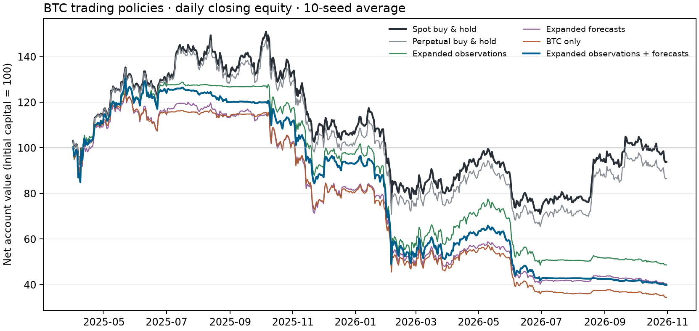

# 2026年11月26日 無料市場データ追加の研究スナップショット

2026-11-28（JST）に、2026-11-26〜27にMacローカルで実行した3実験の保存済み集計を転記した記録。
今回の再学習・独立再計算ではない。3実験とも Test 期間は 2025年4月〜2026年10月の
**既知の歴史Test** であり、独立した未使用holdoutの結果ではない。
主系統 Plan011 v31 の学習条件・validation selector は、この結果で変更していない。

| 実験 | 内容 | 結論 |
|---|---|---|
| [予測](#1-追加データによる4時間先予測) | 追加市場データで急落・急騰確率と分散を予測 | 急落・分散の予測は改善 |
| [BC→PPO](#2-追加データを使ったbcppoの最終損益) | 予測値・観測を入れた新規RLの手取り損益 | 全条件で B&H に大きく劣後 |
| [v31転用](#3-plan011-v31への追加データ投入) | v31 WM→BC→AC に追加列を入力 | BTCのみ・B&Hとほぼ同じ |

追加データは **リスク予測には効くが、売買成績の改善にはまだ結びついていない**。

## 1. 追加データによる4時間先予測

元: `codex_outputs/free_market_20261126`。設計は [design.md](market_data_evidence_20261126/forecast/design.md)。

- 2022年12月〜2026年10月に4取引所の16系列を取得（15分足・1時間足で計1,785,811行）。
  追加群は ETH、アルト10銘柄（BNB・SOL・XRP・ADA・DOGE・LTC・LINK・AVAX・DOT・BCH）の市場横断統計、
  Bybit BTC先物・建玉、Deribit DVOL、Coinbase BTC/USD、Coinbase USDT/USD。追加64列。
  Bybit は約定を集約したローソク足と建玉であり、買い手・売り手別の約定履歴は含まない。
- 新規の市場値はバー終了からさらに15分遅らせて15分の判断時刻に整列した。過去の実際の到着時刻は再現できない。
- 24か月Train → 次の3か月の最終月をVal → 以後最大3か月を歴史Test。3か月ずつずらして7fold。
  共通の有効時点は Val 20,161件、Test 53,811件。4時間先の観測が区間境界をまたぐラベルは除外。
  fold をまたぐと Val の17,201時点が以前の fold の Test にも出現するため、Val と Test は独立した追試ではない。
- 対照は BTC単独の既存84列。線形モデルと LightGBM（120ラウンド等を固定）で計336 fit。
- 指標（小さいほど良い）: 4時間内に直前終値から −2% に到達する確率（急落）、+2% に到達する確率（急騰）の Brier、
  4時間実現分散の QLIKE。
- 有意判定: fold内UTC暦日の循環7日ブロック bootstrap 1万回、split ごとに42比較で Holm 補正。

主な結果（全追加 vs BTC既存入力、同モデル比較）:

| モデル | split | 急落 Brier | 急騰 Brier | 分散 QLIKE |
|---|---|---:|---:|---:|
| LightGBM | Val | 0.05365 → **0.05200** | 0.04419 → 0.04382 | 0.41915 → 0.41200 |
| LightGBM | Test | 0.04509 → **0.04298** | 0.03781 → 0.03713 | 0.43418 → **0.40615** |
| 線形 | Val | 0.05147 → 0.05127 | 0.04449 → 0.04472 | 0.44304 → **0.41645** |
| 線形 | Test | 0.04440 → **0.04313** | 0.03748 → 0.03745 | 0.45131 → **0.41588** |

太字は Holm 補正後も有意だった項目。

- LightGBM 全追加の急落 Brier は Val で 3.07%、Test で 4.66% 改善した。
- 分散予測では **Deribit DVOL 単独** の追加でも線形モデルが大きく改善した（Val 0.41919、Test 0.42325）。
- 急騰は全追加でも Val で多重比較補正を通らなかった。
- 確率の較正: LightGBM 全追加の Test では急落の発生率が全体4.65%、予測上位10%で15.83%。
  上位群の平均予測は23.70%で、危険度を高めに見積もっている。隣り合う判断時点の4時間窓は重なっている。
- 線形の行列計算で数値警告が出た。全予測が有限で確率範囲内、全ロジスティック回帰が反復上限内で終了したことは確認済み。
  fold 0 を独立した計算方法で照合した結果、急落確率の平均絶対差は最大0.049ポイント（個別時点で最大1.26ポイント）。

全条件の表は [metrics.csv](market_data_evidence_20261126/forecast/metrics.csv)、
検定は [paired_tests.csv](market_data_evidence_20261126/forecast/paired_tests.csv)、
fold別は [fold_metrics.csv](market_data_evidence_20261126/forecast/fold_metrics.csv)、
取得件数・欠損は [all_sources.csv](market_data_evidence_20261126/forecast/all_sources.csv)、
生データのhashは [source_hashes.csv](market_data_evidence_20261126/forecast/source_hashes.csv)。

## 2. 追加データを使ったBC→PPOの最終損益

元: `codex_outputs/free_market_rl_20261126`。設計は [design.md](market_data_evidence_20261126/rl/design.md)。
v31 の WM imagination を使わない、新規のオフライン BC→PPO 実験。

- BTCUSDT 無期限先物、2025-04-01〜2026-10-31 UTC（579日）。4時間ごとに判断し、次の15分足の始値で執行。
  0〜2倍ロング、1回あたり ±0.5倍または維持。
- 4条件: ①BTC観測＋BTC予測、②BTC観測＋拡張予測、③拡張観測＋BTC予測、④拡張観測＋拡張予測。
  予測値は1章の LightGBM 急落・急騰確率と線形分散を、時系列的に学習外（OOF）で使う。
- 7fold × 10seed。各 fold は方策Train12か月、Val3か月、Test最大3か月。
  BC 40バッチ、PPO 48更新。16・32・48更新から Val の「最終対数成長 − 0.25×最大DD」で選択（280学習中121件が48更新）。
  長時間学習での収束は未確認。
- コスト: 片道手数料5.5bp、不利な執行幅5bp、実際の Funding、維持証拠金率0.5%。強制清算は全条件で0回。

| 条件 | 最終資金（元手100） | 純損益率 | 現物B&H差 | 平均最大DD | 最悪最大DD（seed） |
|---|---:|---:|---:|---:|---:|
| ① BTCのみ | 34.44 | −65.56% | −59.42pt | 74.43% | 90.47%（7） |
| ② 予測値だけ拡張 | 40.37 | −59.63% | −53.49pt | 72.10% | 85.55%（7） |
| ③ RLへの直接入力だけ拡張 | 48.63 | −51.37% | −45.23pt | 70.99% | 81.90%（23） |
| ④ 両方拡張 | 39.83 | −60.17% | −54.03pt | 73.09% | 83.93%（7） |
| BTC先物の買い持ち | 86.49 | −13.51% | −7.37pt | 56.43% | — |
| BTC現物の買い持ち | 93.86 | −6.14% | +0.00pt | 53.84% | — |

最大DDは下落幅を正値で示す。

- ④−① は +5.39pt（10seed中7seedで改善）だが、日次対数成長差の7日ブロック bootstrap・主比較2件の Holm 補正後 p = 0.1995。
- ④−現物B&H は負で、補正後 p = 0.0172。14日・30日ブロックでも判定は同じ。
- 同じ判断のまま手数料と執行幅をゼロにした事後診断でも ④ は −29.35%（Fundingあり）、全コストゼロでも −27.29%。
  平均のべ約1,866回の建玉調整があった。**損失はコストだけでは説明できない**。
- 学習時の手取りリターンと評価時の口座処理をリポジトリの会計実装と768本（Funding24回）で照合し、
  資産値の最大誤差は開始資金1に対して 8.9×10⁻¹⁶（[account_audit.json](market_data_evidence_20261126/rl/account_audit.json)）。

[seed別](market_data_evidence_20261126/rl/seed_results.csv) ·
[条件別集計](market_data_evidence_20261126/rl/summary.csv) ·
[月別損益](market_data_evidence_20261126/rl/monthly.csv) ·
[検定](market_data_evidence_20261126/rl/paired_tests.csv) ·
[コスト事後診断](market_data_evidence_20261126/rl/cost_diagnostic.csv) ·
[学習選択](market_data_evidence_20261126/rl/training.csv) ·
[凍結hash](market_data_evidence_20261126/rl/frozen_hashes.json)

## 3. Plan011 v31への追加データ投入

元: `codex_outputs/v31_market_transfer_20261126`。主系統の WM→BC→Imagination AC→Test を、
`configs/plan011_overlay_actor_v31_relative_constraint_ac.yaml`（SHA-256 `5c194825…d1fa13`）から
次の点だけ変えて実行した。

- `run.start` / `run.end`: 2023-01-01 / 2026-11-01、1ジョブ1fold、`run.clean_checkpoint_dir: false`
- `data.cache_tag` で専用 cache を指定。`btc` 条件は既存17列、`market` 条件は既存17列＋追加64列＝81列
- `logging.save_test_path: true`（本コミットで追加した fold別 Test 経路の保存。下記）

Test は 2025-04〜2026-09 の四半期6fold と 2026-10 の1か月（計7fold）、seed 10個 × 2条件 = 140 fit、全て完了。
各 fold の Test で決めた保有率を時系列につなぎ、fold 境界を含む実際の保有率変化に本線の売買費用を課した。
現物価格の対数収益会計で、Funding は入力のみ。

| 条件 | 元手100の最終資金 | 平均純損益率 | B&H差 | 平均最大DD | 最悪最大DD（seed） |
|---|---:|---:|---:|---:|---:|
| btc | 93.76 | −6.24% | −0.17pt | 54.25% | 54.31%（7） |
| market | 93.88 | −6.12% | −0.05pt | 54.22% | 54.28%（3） |
| 現物B&H | 93.93 | −6.07% | — | 53.84% | — |

- market − btc の年率対数差は +0.074%、95%CI [−0.068%, +0.239%]、Holm 補正後 p = 0.678。
- market − B&H は −0.037%、補正後 p = 0.924。
- v31 は B&H exposure 1.0 近傍の低回転 overlay のため、追加列を入れても経路はほぼ B&H のまま。
  DD改善も得られていない。
- この Test 期間は v31 holdout（2024-01〜2026-04）と一部重なり、すでに観測済みの期間を含む。

[seed別](market_data_evidence_20261126/v31/seed_results.csv) ·
[fold別](market_data_evidence_20261126/v31/fold_results.csv) ·
[検定](market_data_evidence_20261126/v31/paired_tests.csv) ·
[ジョブ一覧](market_data_evidence_20261126/v31/jobs.csv) ·
[Test経路hash](market_data_evidence_20261126/v31/completion.json)

### `logging.save_test_path`

[train_pipeline.py](../../unidream/experiments/train_pipeline.py) の `run_wfo_folds` は、
`logging.save_test_path: true` のとき各 fold の Test 区間について
`position`・`market_log_return`・`net_log_return` を `fold_<n>/test_path.parquet` に atomic に保存する。
既定は無効で、現行3 config の挙動は変わらない。テストは
[test_train_pipeline_test_path.py](../../tests/test_train_pipeline_test_path.py)。

## 次に検証すべきこと

- 急落確率・DVOL分散の改善を、新しい未使用holdoutで再確認する。
- RL の損失はコストを除いても大きいため、予測精度ではなく方策側（教師・報酬・行動空間）を先に疑う。
- v31 は B&H 近傍に固定されているため、追加情報を DD 制御に使う設計（保有率の下限・変化幅など）が別途必要。

## 保存範囲

市場データ、個別予測、checkpoint、ログは `codex_outputs/` にローカル保存のまま。
本書で使った軽量な集計26ファイルだけを `docs/experiments/market_data_evidence_20261126/` に無加工で転記した。
元path・SHA-256・byte数は [manifest](market_data_evidence_20261126/manifest.json) に記録する。
v31 実験の `inputs.json` はローカルの絶対pathを含むため転記せず、要点を本文に記した。
この集計だけでは学習・推論を replay できない。
